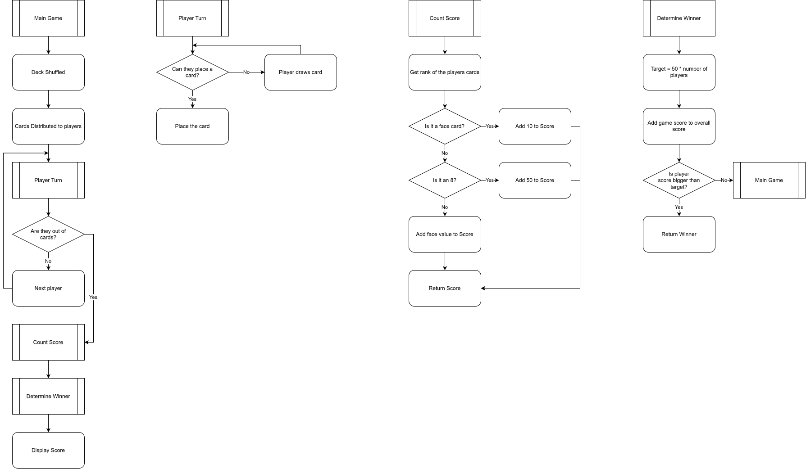

# Crazy-Eights

A game written in C++ based on uno, but using playing cards instead.

## Game Flow

A general flow of the program is below:

### Function breakdown:
|Loop Name|Loop Function|
|-|-|
|Main Game|Represents the core flow of the game|
|Player Turn|The basic loop for each turn for each player|
|Count Score|Calculates the players score based on the values of the othe players cards|
|Determine Winner|And the new score to their overall score and compares it to the target value|